<div align="center">
  
</div>

<br/>

<p align="center">
  <a href="https://github.com/er-Bilim"></a>
  <a href="https://github.com/er-Bilim"></a>
</p>

<div align="center">

<br/>

[](https://wakatime.com/@4cb5727d-c163-4c42-866c-a48cd6d37d56)

</div>

<!--START_SECTION:waka-->

```txt
From: 28 September 2026 - To: 28 October 2026

Total Time: 61 hrs 48 mins

TypeScript       36 hrs 24 mins        ██████████████▓░░░░░░░░░░   58.91 %
Python           13 hrs 19 mins        █████▒░░░░░░░░░░░░░░░░░░░   21.56 %
C++              6 hrs 48 mins         ██▓░░░░░░░░░░░░░░░░░░░░░░   11.00 %
Markdown         2 hrs 18 mins         █░░░░░░░░░░░░░░░░░░░░░░░░   03.74 %
SCSS             1 hr 47 mins          ▓░░░░░░░░░░░░░░░░░░░░░░░░   02.89 %
```

<!--END_SECTION:waka-->
