<div align="center">
  
</div>

<br/>

<p align="center">
  <a href="https://github.com/er-Bilim"></a>
  <a href="https://github.com/er-Bilim"></a>
</p>

<div align="center">

<br/>

[](https://wakatime.com/@4cb5727d-c163-4c42-866c-a48cd6d37d56)

</div>

<!--START_SECTION:waka-->

```txt
From: 30 September 2026 - To: 30 October 2026

Total Time: 54 hrs 35 mins

TypeScript       30 hrs 59 mins        ██████████████▒░░░░░░░░░░   56.77 %
Python           13 hrs 19 mins        ██████░░░░░░░░░░░░░░░░░░░   24.41 %
C++              5 hrs 36 mins         ██▓░░░░░░░░░░░░░░░░░░░░░░   10.28 %
Markdown         2 hrs 18 mins         █░░░░░░░░░░░░░░░░░░░░░░░░   04.23 %
SCSS             1 hr 26 mins          ▓░░░░░░░░░░░░░░░░░░░░░░░░   02.65 %
```

<!--END_SECTION:waka-->
