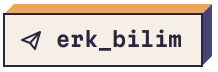

<div align="center">
  
</div>


```yaml
now:
  building:  devio
  shipping:  client work
  studying:  CS @ International University of Kyrgyzstan
  prefers:   writing code > talking about code
```


<p align="center">
  
  
</p>


<p align="center">
  <a href="https://t.me/erk_bilim"></a>
  <a href="https://www.linkedin.com/in/bilim-erkinbekov"></a>
  <a href="https://www.instagram.com/potatokepopo"></a>
</p>


