<div align="center">
  
</div>

<picture><source media="(prefers-color-scheme: dark)" srcset="./assets/divider-dark.svg"></picture>

```yaml
now:
  building:  devio
  shipping:  client work
  studying:  CS @ International University of Kyrgyzstan
  prefers:   writing code > talking about code
```

<picture><source media="(prefers-color-scheme: dark)" srcset="./assets/divider-dark.svg"></picture>

<p align="center">
  
  
</p>

<picture><source media="(prefers-color-scheme: dark)" srcset="./assets/divider-dark.svg"></picture>

<p align="center">
  <a href="https://t.me/erk_bilim"></a>
  <a href="https://www.linkedin.com/in/bilim-erkinbekov"></a>
  <a href="https://instagram.com/esoatna"></a>
</p>

<picture><source media="(prefers-color-scheme: dark)" srcset="./assets/footer-dark.svg"></picture>
